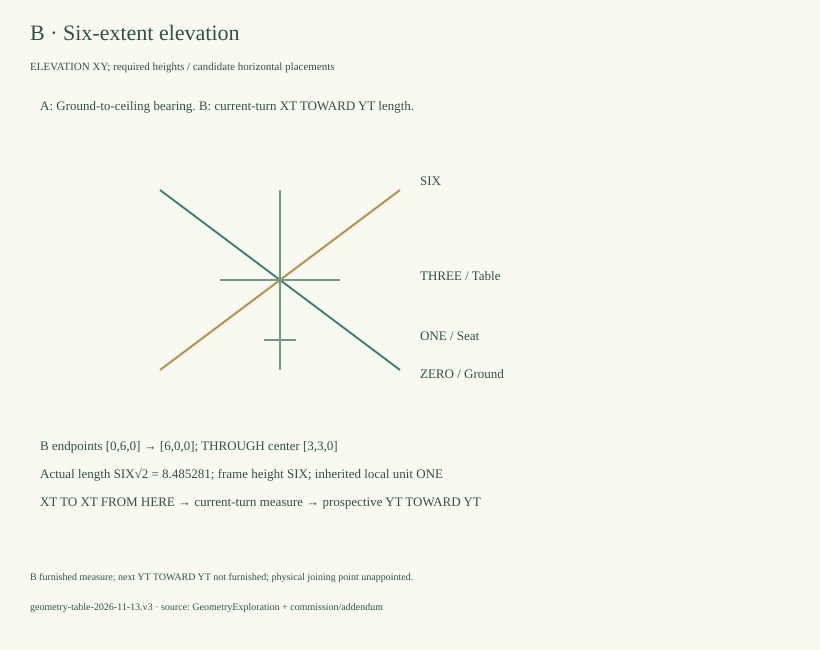

# XT TO XT, XT TOWARD YT, Diagonal Bearings, and the Continuous Pillar

[Geometry RE-surfacing Table](README.md) · Version `geometry-table-2026-11-13.v4`

**ESTABLISHED ARCHITECTURAL REQUIREMENT — R05.** Diagonal A is the fixed lower-left→upper-right 45-degree XT TOWARD YT bar in elevation. **DIAGONAL B FURNISHES THE LENGTH OF XT TOWARD YT FOR THIS ONE CURRENT TURN**, upper-left→lower-right THROUGH the center. It is not a decorative crossed reference. Do not identify material length with projected rise.

**SOURCE-BACKED IMPLEMENTED GEOMETRY.** A=[0,0,0]→[6,6,0]; B=[0,6,0]→[6,0,0]. Both have rise magnitude SIX, run SIX and length SIX√2. Their shared center is [3,3,0]. The inherited Paired Motor XT TO XT unit bar remains its own source object, not this diagonal and not the six-high HERE pillar. The new witness registers a distinct local `xt-to-xt-from-here` unit marker [3,0,−4]→[3,1,−4]; that vertical placement is a candidate embedding of the established ZERO-TO-ONE office, not an identity bridge to the old motor frame.

**CANDIDATE EXPERIMENT.** Projectioning connection [3,3,−4]→[3,3,0] relates the pillar's THREE reference to the Crossing without identifying the pillar with the Gallery axle. Source diagonal bearings remain fixed while candidate triangle specimens move.

**UNPROVED MECHANICAL OR OPTICAL RELATIONSHIP.** Diagonal B's resolution THROUGH the bobbing apparatus is not proven by intersecting two lines in elevation. A 2D intersection is not a 3D hinge or shaft witness.

**ESTABLISHED ARCHITECTURAL REQUIREMENT — R20.** Nothing new is automatically Projectioning beyond Diagonal B: the next YT TOWARD YT has not been appended. Distinguish current-turn line furnished, continuation proposed, continuation furnished and continuation lawfully acquired. Subsequent lawful continuation must inherit FROM XT TO XT FROM HERE through the current-turn measure. Proposal/Regarding changes neither the current measure nor constitutional acquisition.

**SOURCE-BACKED IMPLEMENTED GEOMETRY.** `current_turn_measure/0` preserves endpoints, center, actual length SIX√2 ≈ 8.485281 trial extents, frame ID, current preview-turn ID, local-unit basis and related A/pillar/Crossing identities. A current line instrument is furnished; this does not declare a protected acquired Human turn. Default next extent is `not_furnished`, with empty material points and no physical join point appointed. The hidden-by-default prospective overlay is only a halo at the known B boundary reference. It draws no speculative material path and does not increase the SIX frame.

**UNPROVED MECHANICAL OR OPTICAL RELATIONSHIP.** Endpoint [6,0,0] is a boundary reference, not proof of the physical material joining point. Joining interface, folding/deformation law and lawful acquisition witnesses remain open. See the [byte-preserved addendum](diagonal-b-addendum-2026-11-13.txt), [change ledger](change-ledger.md), [framing](six-extent-framing.md), [Crossing](table-crossing-staging.md), [acquisition](lawful-acquisition.md) and [DIRT contract](dirt-contract.md).

**ESTABLISHED ARCHITECTURAL REQUIREMENT — [R21–R23](un-vanishing-aperture.md).** Staging THROUGH-BY the UN-VANISHING opening preserves the current-turn B measure and prospective-continuation boundary. It does not append new YT TOWARD YT or grant acquired FROM DOWN UNDER. See [staging](table-crossing-staging.md), [acquisition](lawful-acquisition.md) and [angular hypothesis](gallery-axle-map.md).

The SVG declares view, frame, material IDs and qualification. Relational drawings are not 3D folding proof.

Implementation: `lib/public_situation_machine_turn_zero/workshop/geometry_exploration.ex` and `lib/public_situation_machine_turn_zero_web/components/geometry_exploration_panel.ex`, unless historical sources are explicitly named above. Current tests: `test/public_situation_machine_turn_zero/geometry_exploration_test.exs` and the matching LiveView/browser tests. Source authority: [commission](commission-2026-11-13.txt), relevant named section; verification status in [report](validation-report.md).

Adjoining records: [Six-Extent CUBICAL Registration and RE-STEPPING Framing](six-extent-framing.md) · [Standing Up Table, Projectioning Crossing, and Staging](table-crossing-staging.md).

**ESTABLISHED ARCHITECTURAL RELATIONSHIP — [R25/R26](here-wedging-snail-six.md).** HERE is not merely a post: seated ONE stands THROUGH its local wedging, TOWARD THREE/OVER ACROSS, with required Snail House registration THROUGH SIX. SIX frame, local XT TO XT and prior acquisition duties remain established. Return-line intersection, occupied joining, optics and securing are UNPROVED IMPLEMENTATION MECHANISMS; a registered cube alone proves no lawful acquisition. Compare the [two bounded trials](here-wedging-snail-six.md).
