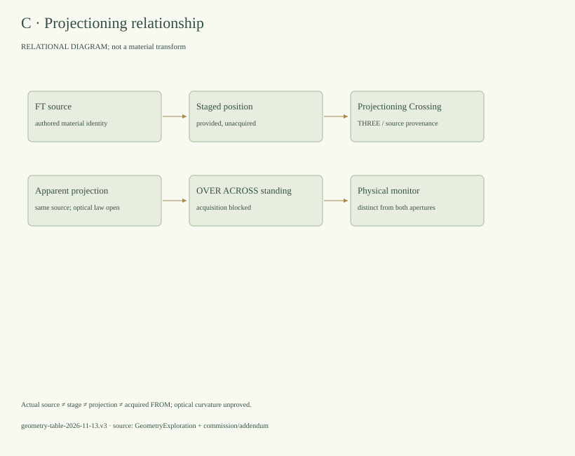

# DIRT Geometry and Acquisition Provenance

[Geometry RE-surfacing Table](README.md) · Version `geometry-table-2026-11-13.v4`

**ESTABLISHED ARCHITECTURAL REQUIREMENT — R18.** DIRT distinguishes geometry proposed, geometry furnished and extent acquired. Geometry version/identity, FT issuance, TF taking, frame, selected wedging, FROM and index, source Footing, conditions, exit, button eligibility/encounter, return, securing, axle/pocketing, ceiling and Regarding are not one generic event.

**CANDIDATE EXPERIMENT.** Extend the existing DIRT `start + ordered consequences` design with `geometry_contract`, `registry_hash`, `material_id`, `material_address`, `source_version`, `frame_id`, `unit`, `office`, `acquisition_scope`, `witness_dependencies`, `before_hash`, `after_hash`, `proposal_result`, `condition_id` and exact ordered prepositioning. Accepted candidate material placement is not constitutional acquisition. Historical version adapters must validate compatibility before reconstruction.

A rejected fold records candidate inputs and interfering face IDs without replacing accepted geometry. A physical acquisition record must atomically bind securing evidence, prior FROM/index and resulting standing; no current rehearsal record may be promoted by changing its tag. An entry may inherit its meaning from earlier condition/material records. Unknown dependencies, unsupported transforms, stale revisions and unreproducible geometry reject.

See the [concrete extension contract](dirt-contract.md) and [existing DIRT design](../../dirt-design/README.md). Phoenix LiveView owns interaction/evaluation orchestration. External computations may use user-configurable webhooks; no production Python evaluator is introduced. The session journal is not a validated DIRT CSV export.

**ESTABLISHED ARCHITECTURAL REQUIREMENT — [R20](diagonals-pillar.md).** DIRT must distinguish `current_turn_line_furnished`, `future_continuation_proposed`, `future_continuation_furnished` and `future_continuation_lawfully_acquired`, preserving measured endpoints/length, preview vs actual turn scope and the XT TO XT FROM HERE inheritance chain.

**ESTABLISHED ARCHITECTURAL REQUIREMENT — [R21–R23](un-vanishing-aperture.md).** The newer lifecycle is staged alongside → material furnished → lawful Landinging acquisition → acquired FROM DOWN UNDER relationship → subsequent permitted COB working, conditioned on the Human’s prior acquired frame. Scope/provenance distinguish all preview fixtures from actual acquisitions. See [staging](table-crossing-staging.md), [acquisition](lawful-acquisition.md) and [angular hypothesis](gallery-axle-map.md).

The SVG declares view, frame, material IDs and qualification. Relational drawings are not 3D folding proof.

Implementation: `lib/public_situation_machine_turn_zero/workshop/geometry_exploration.ex` and `lib/public_situation_machine_turn_zero_web/components/geometry_exploration_panel.ex`, unless historical sources are explicitly named above. Current tests: `test/public_situation_machine_turn_zero/geometry_exploration_test.exs` and the matching LiveView/browser tests. Source authority: [commission](commission-2026-11-13.txt), relevant named section; verification status in [report](validation-report.md).

Adjoining records: [Flat, Tunnel, THROUGH, ALONG, and Other Regardings](regardings-projection.md) · [Historical Geometry, Supersession, and Repository Reconciliation](history-reconciliation.md).

**ESTABLISHED ARCHITECTURAL RELATIONSHIP — [R25/R26](here-wedging-snail-six.md).** HERE is not merely a post: seated ONE stands THROUGH its local wedging, TOWARD THREE/OVER ACROSS, with required Snail House registration THROUGH SIX. SIX frame, local XT TO XT and prior acquisition duties remain established. Return-line intersection, occupied joining, optics and securing are UNPROVED IMPLEMENTATION MECHANISMS; a registered cube alone proves no lawful acquisition. Compare the [two bounded trials](here-wedging-snail-six.md).

The [local 45° bearing registration](bearing-registration-study.md) adds inspection evidence for exact local bearings, face/point registration, section axes and failed finite sweep, aperture and Ground bounds. Preserve the drawing and inclination correction separately from the historical 35.264° body-diagonal witness. These inspections generate no acquisition receipt or index change.
