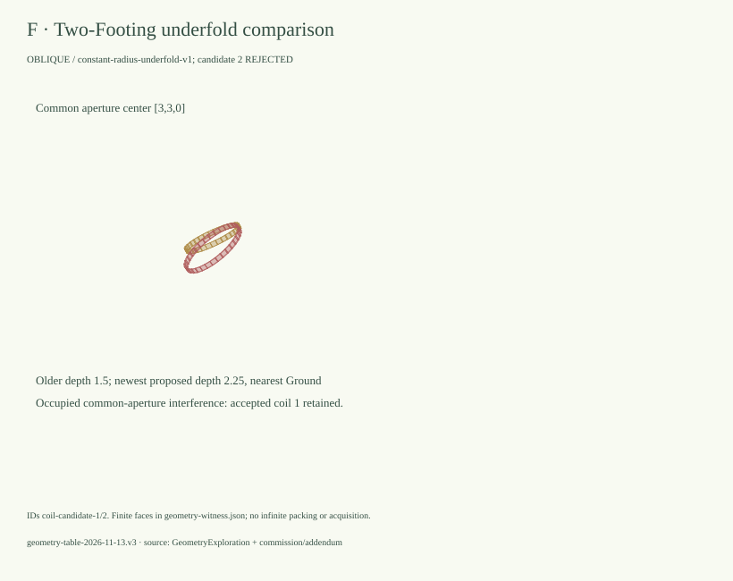

# Little ROUNDING Footings, Accretioning, and Asymptotic Folding

[Geometry RE-surfacing Table](README.md) · Version `geometry-table-2026-11-13.v4`

**ESTABLISHED ARCHITECTURAL REQUIREMENT — R12.** Little ROUNDING Footings are coils, not detached platforms. EACH LITTLE ROUNDING FOOTING STANDS THROUGH THE CENTER OF THE APERTURE AND FOLDS UNDER FROM WITHIN. The most recent fold stands nearest the floor; older folds accretion into the manifold. At least TWO-Footing construction capacity precedes acquisition; no Footings are pre-created by that capacity.

**CANDIDATE EXPERIMENT.** The bounded specimen uses the SAME radius for each coil, decreasing vertical purchase intervals, explicit finite-width/thickness Ribbon faces and a common center incidence. It explores ordered placement, not progressively smaller circles. Newer proposals become nearer the floor; existing material IDs and material addresses persist while their proposed placement changes. Placement is not a rigid motion/conservation proof.

**UNPROVED MECHANICAL OR OPTICAL RELATIONSHIP.** Finite thickness prevents an infinite physically clear geometric series in a bounded volume. Reject sampled occupied contact before adding a candidate; retain current specimen on rejection. The mathematical asymptote is a comparison, not a solved mechanism. The common center may force a collision even for the first pair: disclose that result rather than displacing the aperture or shrinking material.

There is no canonical maximum Footing count. Session limits are explicitly resource bounds, independent of Lanterning Bug count. No actual Footing is acquired in the geometry preview.

The SVG declares view, frame, material IDs and qualification. Relational drawings are not 3D folding proof.

Implementation: `lib/public_situation_machine_turn_zero/workshop/geometry_exploration.ex` and `lib/public_situation_machine_turn_zero_web/components/geometry_exploration_panel.ex`, unless historical sources are explicitly named above. Current tests: `test/public_situation_machine_turn_zero/geometry_exploration_test.exs` and the matching LiveView/browser tests. Source authority: [commission](commission-2026-11-13.txt), relevant named section; verification status in [report](validation-report.md).

Adjoining records: [Constitutional RE-STEP and Lawful Acquisition](lawful-acquisition.md) · [PENDING UN-BUTTONING, Tunnel Conditions, and Return Course](pending-return-conditions.md).
