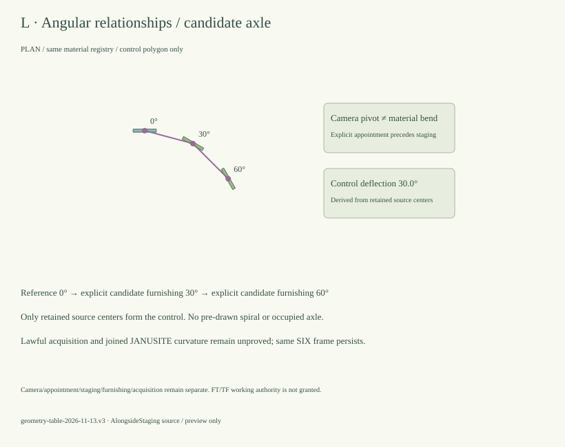
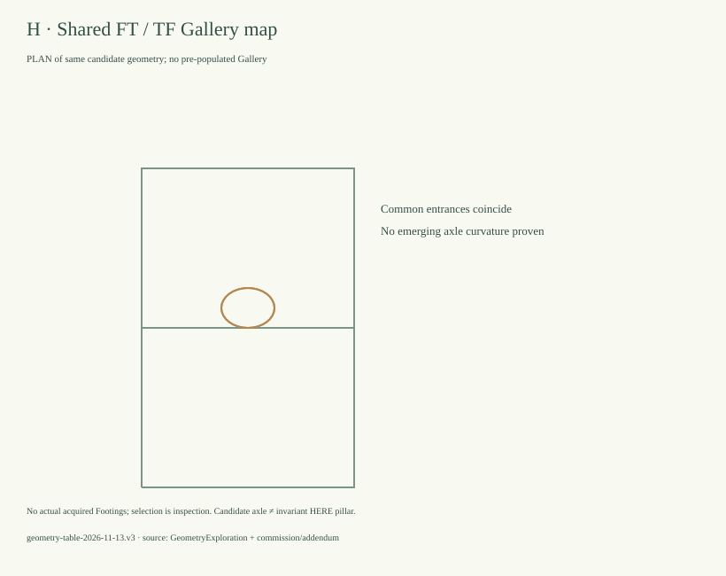

# Roundabout Gallery, Axle Curvature, Pocketings, and Map Regarding

[Geometry RE-surfacing Table](README.md) · Version `geometry-table-2026-11-13.v4`

**ESTABLISHED ARCHITECTURAL REQUIREMENT — R16.** HERE pillar, candidate curved Gallery axle OVER ACROSS, local coils/pocketings, acquired COB standing and selected Regarding locality are distinct identities. Map selection does not re-stand or acquire the COB.

**CANDIDATE EXPERIMENT.** Shared FT/TF plan reads the same furnished/candidate material arrays as section and transverse views. No full Gallery is pre-populated. Candidate axle is inferred only from currently accepted candidate entrance centers; it cannot become a prescribed final spiral. A one-center or degenerate same-center chain may fail to establish curvature; expose that rather than manufacturing it.

Map draws actual candidate entrances, material orientation arrows, selected inspection reference and eligibility reason. All entries are candidate/unacquired in the real exploration; the condition-contract fixture is a separate scope. The projection never turns a candidate into actual Footing.

**UNPROVED MECHANICAL OR OPTICAL RELATIONSHIP.** Twist-through-pocketing, finite Craft clearances and the law producing the Gallery's axle curvature await experiment. This new candidate axle does not supersede N18's return role or reposition its source coordinates.

**CANDIDATE EXPERIMENT — R24.** Curving Gallery axle may emerge through successive differentiated angular appointments, material staged alongside inherited standing, reciprocal FT/TF furnishing and taking, subsequent lawful Landinging acquisition and further Segmentationing relationships in the same frame. Human Regarding can motivate an appointment; a camera pivot alone never mechanically bends JANUSITE.

**SOURCE-BACKED IMPLEMENTED GEOMETRY.** The angular witness derives a polygonal registration control only from the inherited reference and explicitly retained candidate furnishings. It starts with one point and no curvature. Two differently appointed candidate furnishings can produce a measured control deflection; it is not a bent occupied axle, continuous Gallery, actual acquired material or a pre-drawn spiral. Each control point names its source specimen, angle, frame and status. Camera changes leave these points unchanged. This supplements, not overwrites, the earlier coincident-entrance coil control.

**UNPROVED MECHANICAL OR OPTICAL RELATIONSHIP.** Joining finite material at angular interfaces, lawful acquisition, deformation/supply conservation and occupied axle profiles remain open. A non-collinear control polygon is not proof of the hypothesis's full physical/constitutional sequence.

See [staging R21](table-crossing-staging.md), [opening R23](un-vanishing-aperture.md) and [acquisition R22](lawful-acquisition.md).

The SVG declares view, frame, material IDs and qualification. Relational drawings are not 3D folding proof.

Implementation: `lib/public_situation_machine_turn_zero/workshop/geometry_exploration.ex` and `lib/public_situation_machine_turn_zero_web/components/geometry_exploration_panel.ex`, unless historical sources are explicitly named above. Current tests: `test/public_situation_machine_turn_zero/geometry_exploration_test.exs` and the matching LiveView/browser tests. Source authority: [commission](commission-2026-11-13.txt), relevant named section; verification status in [report](validation-report.md).

Adjoining records: [PENDING UN-BUTTONING, Tunnel Conditions, and Return Course](pending-return-conditions.md) · [Flat, Tunnel, THROUGH, ALONG, and Other Regardings](regardings-projection.md).

**ESTABLISHED ARCHITECTURAL RELATIONSHIP — [R25/R26](here-wedging-snail-six.md).** HERE is not merely a post: seated ONE stands THROUGH its local wedging, TOWARD THREE/OVER ACROSS, with required Snail House registration THROUGH SIX. SIX frame, local XT TO XT and prior acquisition duties remain established. Return-line intersection, occupied joining, optics and securing are UNPROVED IMPLEMENTATION MECHANISMS; a registered cube alone proves no lawful acquisition. Compare the [two bounded trials](here-wedging-snail-six.md).
