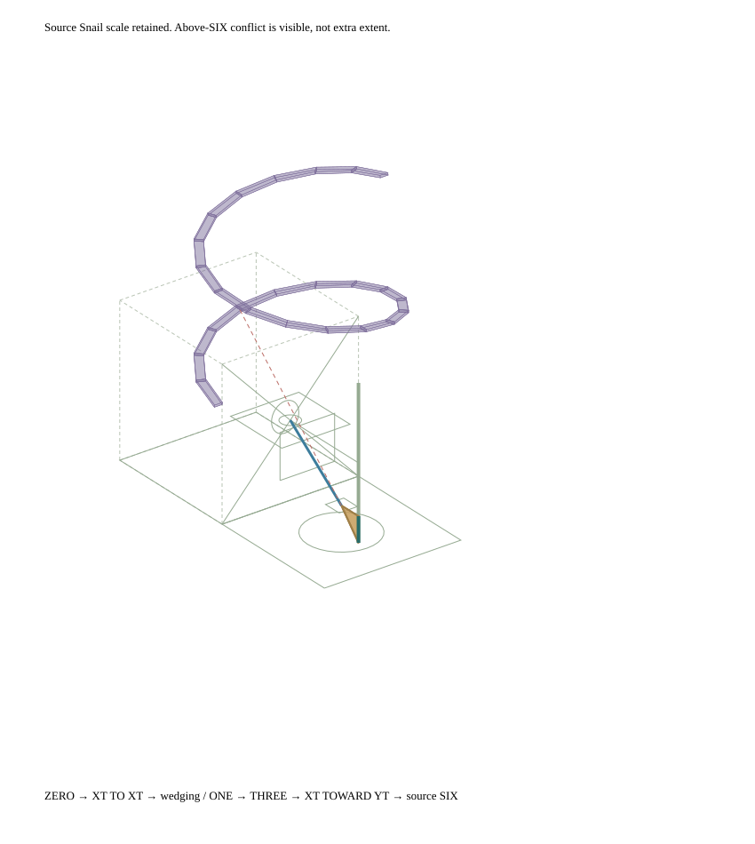

# HERE wedging, seated point ONE and Snail House THROUGH SIX

[Geometry RE-surfacing Table](README.md) · `geometry-table-2026-11-13.v4` · [governing addendum](here-wedging-addendum-2026-11-13.txt).

**ESTABLISHED ARCHITECTURAL RELATIONSHIP — R25.** The six-high HERE reference has a ZERO-TO-ONE material wedging relationship. The Constitutioning Human's seated locality at ONE stands THROUGH A POINT IN THE HERE WEDGING, FROM ZERO, FROM WITHIN XT TO XT, TOWARD ONE and material OVER ACROSS. Seat ONE stands TOWARD Table THREE. The invariant reference, local unit, material wedge, seated point and bearing are distinct. No additional pillar or extent is furnished.

**ESTABLISHED ARCHITECTURAL RELATIONSHIP — R26.** The HERE square must stand in geometric relation to XT TOWARD YT OVER ACROSS. Snail House geometry must stand THROUGH WITH the wedging BY WAY OF Segmentationing SIX. This mutual registration is required, not decorative or optional. NEXT never becomes HERE. Snail House's one-complete-Tuple-Ship scale relationship may not be replaced by a larger Public Field.

**CANDIDATE EXPERIMENT.** Two accounts remain open: (1) the inherited acquired-Landinging departure/return bearing and current XT TOWARD YT return line resolve a wedge THROUGH ONE; (2) invariant XT TO XT is the material wedge and bearings differentiate its presentation. Neither has been selected as canonical mechanism.

**SOURCE-BACKED IMPLEMENTED GEOMETRY.** `HereWedging.model/0` uses the existing local unit [3,0,−4]→[3,1,−4] and Seat point [3,1,−3] as a finite triangular-prism trial, thickness 0.04. ONE is an actual source vertex; the unit leg remains length ONE, pillar remains SIX. Seat→Table bearing terminates at [3,3,0]. Circle, HERE/NEXT squares and diagonals use the existing references unchanged. Left/right views project the identical world arrays, not two reflected constitutional extents.

Inherited return source is `MaterialRibbon.return_register/0`, retaining `n-ground-return`, `machine-from-n`, U13 and its original source points. Its existing source-to-motor comparison is preserved. No physical motor-to-exploration transform or previous lawful acquisition is attested. Diagonal B is available as current-turn measure, **not silently appointed as the current return line**. The return-intersection trial is therefore explicitly blocked; it creates no fake occupied wedge or convenient endpoint.

The integrated Snail study uses `SnailBody.reference_arc/0`, `arc_frame/1` and the exact existing `ComingAboardMachine.snail_point/1` scale 6/1.4. A finite candidate rectangular carrier follows the actual analytic source, rather than an unrelated spiral. The sixth source purchase is t=5/6; associating this sample with constitutional Segmentationing SIX is a **candidate correspondence**, not an identity proof. A rigid translation places this reference at candidate target [3,6,3]. The source scale and curve are not refitted.

**UNPROVED IMPLEMENTATION MECHANISM.** The resulting full source helix exceeds ceiling SIX. This is exposed as a failed fit, not an enlarged frame or license to shrink the Snail. The carrier is an inspection construction, not the entire manufactured radial-fold Snail House or a cleared tunnel. A dashed ONE→SIX registration link expresses required correspondence, not a solid join. Actual sample-to-Segmentationing mapping, finite material incidence, inherited/current return intersection, hinge/twist, clearance and optical transfer remain unproved.

The established one-Tuple-Ship scale duty is retained; the old common-machine transform is a source-backed comparison scale, not proof of complete physical mounting. Further scale correspondence must be reviewed rather than silently solved by normalization.

## Integrated witness

`/workshop/string-ribbon` → HERE wedging study → compare simple/return trials → Regard left/right → inspect source ledger. The sequence ZERO → XT TO XT → occupied wedge / seated ONE → Table THREE → XT TOWARD YT → source Snail/SIX is inspectable in one scene. All material remains preview/unacquired. FT/TF working requires the Human's lawfully acquired frame; no new RE-STEP is introduced.

Related records: [HERE](human-here-landingings.md), [framing/classification](six-extent-framing.md), [diagonals](diagonals-pillar.md), [Table](table-crossing-staging.md), [JANUSITE](janusite-material.md), [Gallery](gallery-axle-map.md), [DIRT](dirt-contract.md), [report](validation-report.md).

