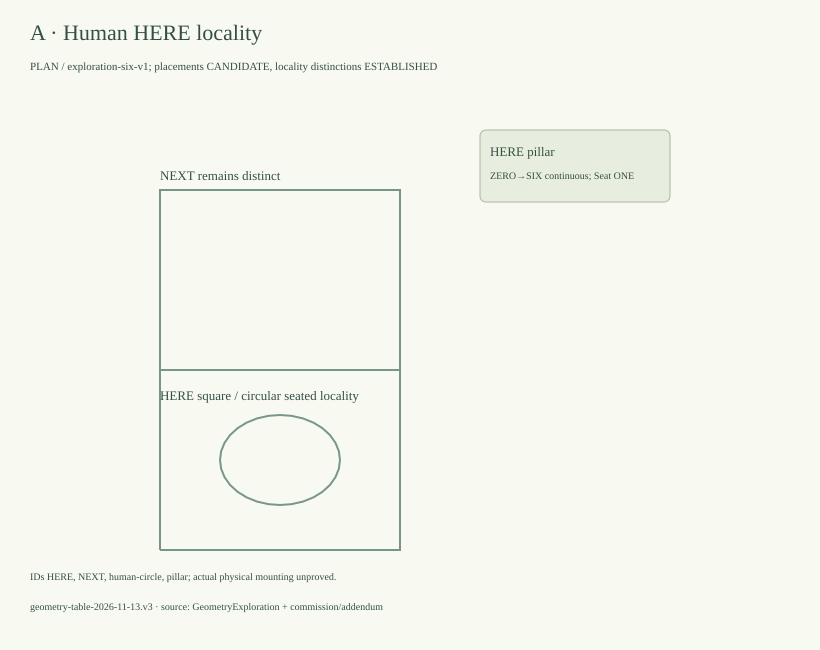

# Historical Geometry, Supersession, and Repository Reconciliation

[Geometry RE-surfacing Table](README.md) · Version `geometry-table-2026-11-13.v4`

**ESTABLISHED ARCHITECTURAL REQUIREMENT — R19.** EXECUTABLE OLD GEOMETRY DOES NOT OVERRIDE CURRENT ARCHITECTURAL REQUIREMENTS. Preserve old source coordinates, revisions, diagrams and event ancestry. Reusing quarry requires a compatibility review.

**SUPERSEDED HISTORICAL ASSUMPTION.** Table at Ground / Craft Seat SIX above the same datum cannot govern the new Ground ZERO / Seat ONE / Standing Up Table THREE / ceiling SIX picture. PairedMotor [t,t,t] straight succession is a control, not ordered coiling UNDER FROM WITHIN. Its per-trial index zero remains valid. The old SIX arc being a proposed mandatory material path is superseded; its role is reference geometry.

The [impact ledger](impact-ledger.md) names exact modules/functions, old assumptions, compatibility, notices and required future work. Existing experiments remain executable under disclosed historical/trial status. No broad geometry rewrite, UUID standing migration, branch reset or erasure is authorized.

The byte-preserved [13 November commission](commission-2026-11-13.txt) is the architectural authority for this revision; the [Material Ribbon report](../../material-ribbon-construction-2026-11-13.md) is an implementation witness, not authority over a later Human requirement.

The SVG declares view, frame, material IDs and qualification. Relational drawings are not 3D folding proof.

Implementation: `lib/public_situation_machine_turn_zero/workshop/geometry_exploration.ex` and `lib/public_situation_machine_turn_zero_web/components/geometry_exploration_panel.ex`, unless historical sources are explicitly named above. Current tests: `test/public_situation_machine_turn_zero/geometry_exploration_test.exs` and the matching LiveView/browser tests. Source authority: [commission](commission-2026-11-13.txt), relevant named section; verification status in [report](validation-report.md).

Adjoining records: [DIRT Geometry and Acquisition Provenance](dirt-geometry-provenance.md) · [Open Geometric Questions and Experimental Witnesses](open-questions-witnesses.md).
