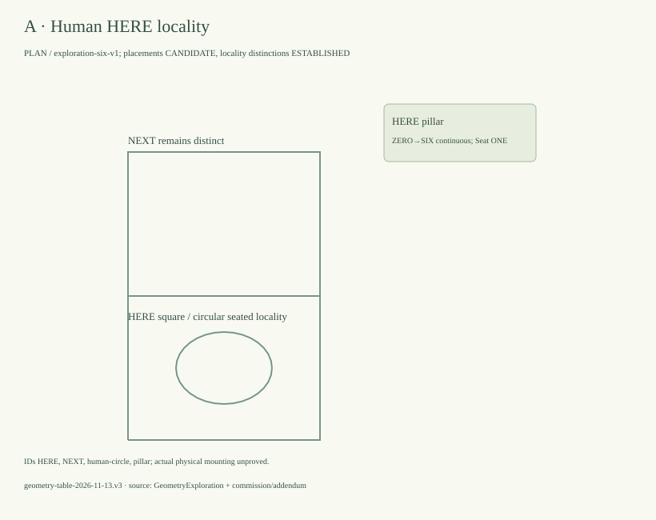

# Constitutioning Human, HERE, and Landingings

[Geometry RE-surfacing Table](README.md) · Version `geometry-table-2026-11-13.v4`

**ESTABLISHED ARCHITECTURAL REQUIREMENT — R01.** The Constitutioning Human remains seated FROM HERE. THIS ONE STANDINGING LANDINGING is the circular seated locality; THIS HERE APPROACHING LANDINGING is the persistent square HERE; THIS NEXT APPROACHING LANDINGING is the differentiated square OVER ACROSS. NEXT does not become HERE. The ordinary flat monitor remains the physical monitor, not a transported Human avatar.

**ESTABLISHED ARCHITECTURAL REQUIREMENT — R02.** One continuous HERE pillar rises from Ground ZERO to SIX immediately behind the seated locality. Seat at ONE, pointing seam around TWO, Standing Up Table / Projectioning Crossing at THREE and ceiling SIX have different offices. The pillar neither changes length nor follows AROUND ABOUT bearing.

**CANDIDATE EXPERIMENT.** The exploration places HERE at X=0..6,Z=−6..0; NEXT at X=0..6,Z=0..6; Y=0. Human ground locality center [3,0,−3], pillar [3,0,−4]→[3,6,−4], Seat [3,1,−3]. These horizontal placements are reversible workshop choices, not recovered physical dimensions. Table center [3,3,0] is a separate locality. No fixed Seat/Table co-rotation is assumed.

**OPEN ARCHITECTURAL QUESTION.** Exact inscription of the interlocking HERE/NEXT relation remains provisional; section 02 of the source is an intention, not a finalized quotation. Under-seat wedging is a candidate office, not an occupied mechanism.

Witnesses: identical HERE/pillar coordinates across all views, furnishing and proposed folds; no acquired Human transport.

**ESTABLISHED ARCHITECTURAL REQUIREMENT — [R21–R23](un-vanishing-aperture.md).** A Human pivot changes Regarding. Explicit Human appointment and subsequent staging are different occasions; no source material is moved by that pivot alone. See [staging](table-crossing-staging.md), [acquisition](lawful-acquisition.md) and [angular hypothesis](gallery-axle-map.md).

The SVG declares view, frame, material IDs and qualification. Relational drawings are not 3D folding proof.

Implementation: `lib/public_situation_machine_turn_zero/workshop/geometry_exploration.ex` and `lib/public_situation_machine_turn_zero_web/components/geometry_exploration_panel.ex`, unless historical sources are explicitly named above. Current tests: `test/public_situation_machine_turn_zero/geometry_exploration_test.exs` and the matching LiveView/browser tests. Source authority: [commission](commission-2026-11-13.txt), relevant named section; verification status in [report](validation-report.md).

Adjoining records: [Open Geometric Questions and Experimental Witnesses](open-questions-witnesses.md) · [Six-Extent CUBICAL Registration and RE-STEPPING Framing](six-extent-framing.md).

**ESTABLISHED ARCHITECTURAL RELATIONSHIP — [R25/R26](here-wedging-snail-six.md).** HERE is not merely a post: seated ONE stands THROUGH its local wedging, TOWARD THREE/OVER ACROSS, with required Snail House registration THROUGH SIX. SIX frame, local XT TO XT and prior acquisition duties remain established. Return-line intersection, occupied joining, optics and securing are UNPROVED IMPLEMENTATION MECHANISMS; a registered cube alone proves no lawful acquisition. Compare the [two bounded trials](here-wedging-snail-six.md).
