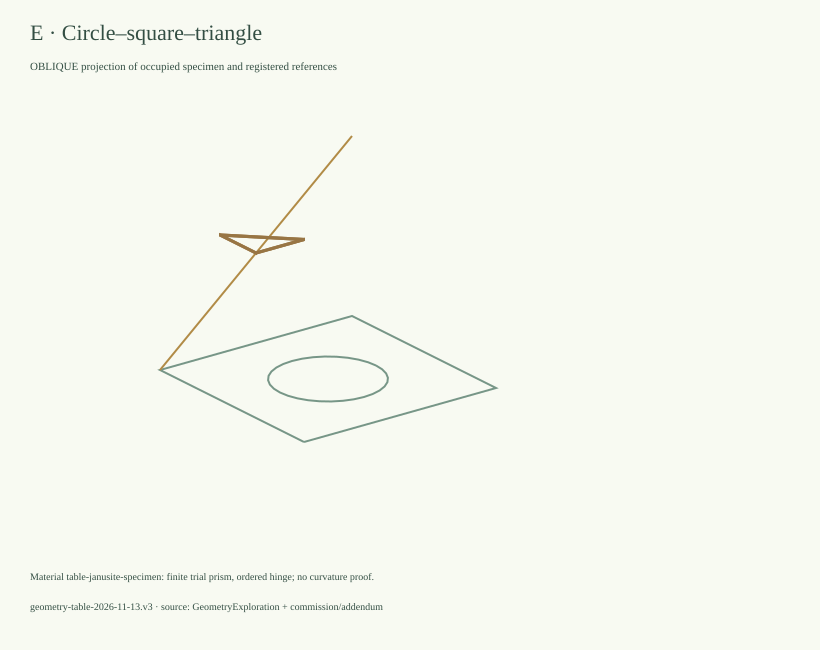

# JANUSITE, Triangles, Squares, Circle, and Material Folding

[Geometry RE-surfacing Table](README.md) · Version `geometry-table-2026-11-13.v4`

**ESTABLISHED ARCHITECTURAL REQUIREMENT — R07.** JANUSITE is ribbonating substrate. An occupied triangle claim requires finite faces/thickness, ordered hinge and clearance, not an outline. Rigid rotation, intrinsic curvature and projected curvature remain different operations.

**SOURCE-BACKED IMPLEMENTED GEOMETRY.** Existing `MaterialRibbon.prism/3` retains area 18, side lengths 6/6/√72, finite thickness 0.04 and ordered hinge A TOWARD B. Its reciprocal reflection is a diagnostic trial, not gearing. Stable `archway:*` IDs are independent of authored cargo.

**CANDIDATE EXPERIMENT.** New source specimen is a smaller rigid triangle attached to the Table center; bounded Crossing/Seat pivot placements and X/Y axis alternatives are separately named. X retains the attached stock leg; Y proposes planar AROUND ABOUT swing TOWARD HERE while its attached-edge incidence stays unproved. Both are rigid transformations, not intrinsic curvature. Swept coil Ribbon has material-addressed front/back/side faces, constant finite width and thickness, with two differently placed branches around a registered diameter. It is not manufactured JANUSITE or a strain/conservation proof. Outward swing and a coiling mechanism are compared, not silently equated.

**UNPROVED MECHANICAL OR OPTICAL RELATIONSHIP.** Contacts at the Table aperture, real hinge clearance, twist/strain, supply, holding, gathering and returned continuation still need mechanical witnesses. Collision rejection cannot be overridden by changing a camera.

**ESTABLISHED ARCHITECTURAL REQUIREMENT — [R21–R23](un-vanishing-aperture.md).** New finite material can be staged alongside inherited standing without acquiring its Groundward relationship. Explicit angular material registration is a candidate furnishing operation; a pivot of Regarding does not rotate or bend the actual source material. See [staging](table-crossing-staging.md), [acquisition](lawful-acquisition.md) and [angular hypothesis](gallery-axle-map.md).

The SVG declares view, frame, material IDs and qualification. Relational drawings are not 3D folding proof.

Implementation: `lib/public_situation_machine_turn_zero/workshop/geometry_exploration.ex` and `lib/public_situation_machine_turn_zero_web/components/geometry_exploration_panel.ex`, unless historical sources are explicitly named above. Current tests: `test/public_situation_machine_turn_zero/geometry_exploration_test.exs` and the matching LiveView/browser tests. Source authority: [commission](commission-2026-11-13.txt), relevant named section; verification status in [report](validation-report.md).

Adjoining records: [Standing Up Table, Projectioning Crossing, and Staging](table-crossing-staging.md) · [FT COB, TF COB, Traversaling Craft, and Reciprocal Offices](reciprocal-offices-craft.md).

**ESTABLISHED ARCHITECTURAL RELATIONSHIP — [R25/R26](here-wedging-snail-six.md).** HERE is not merely a post: seated ONE stands THROUGH its local wedging, TOWARD THREE/OVER ACROSS, with required Snail House registration THROUGH SIX. SIX frame, local XT TO XT and prior acquisition duties remain established. Return-line intersection, occupied joining, optics and securing are UNPROVED IMPLEMENTATION MECHANISMS; a registered cube alone proves no lawful acquisition. Compare the [two bounded trials](here-wedging-snail-six.md).

Current [JANUSITE / shared-YT / ONE-to-TWO refinement](janusite-shared-yt-one-two.md) adds R27–R30 without repairing the preserved v4 failed fit or granting acquisition.

Current [v6 assembled CUBICAL / Crossing requirements R31–R36](cubical-construction-2026-11-15.md) preserve this source witness. Initial straight-UP approach, whole-frame versus local ceilings, distinct LEFT/RIGHT material and THREE/FOUR comparison must be read under that refinement. No historical candidate or failed fit becomes actual acquisition.

V7 material co-building refinement: [R37–R43](co-building-material-2026-11-15.md) and [finite geometry / interfaces / witnesses](co-building-engineering-report-2026-11-15.md). Earlier source registrations and their versioned scope remain retained.
