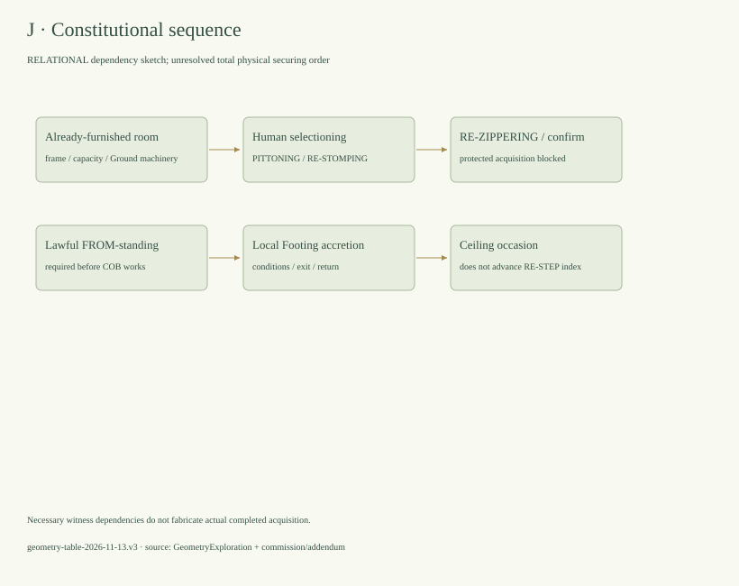

# Constitutional RE-STEP and Lawful Acquisition

[Geometry RE-surfacing Table](README.md) · Version `geometry-table-2026-11-13.v4`

**ESTABLISHED ARCHITECTURAL REQUIREMENT — R10.** The room is furnished before the Human RE-STEPS. Human selectioning, already-furnished frame, Ground connection, PITTONING, appropriate RE-STOMPING, RE-ZIPPERING/securing and completion confirmation are required witnesses. Mere button/animation completion cannot acquire FROM-standing.

**ESTABLISHED ARCHITECTURAL REQUIREMENT — R11.** THE COB IS ALWAYS RE-STEPPING TOWARD FROM WITHIN THIS ONE FRAMING. The COB does not travel to RE-STEP as a destination. Local Footing, completed circuit, ascent and ceiling occasion are not new constitutional RE-STEPS.

Dependency proposal: frame appointment precedes material provision/capacity and selection; Ground connection precedes secure purchase; PITTONING precedes an accepted secured FROM; appropriate RE-STOMPING and RE-ZIPPERING precede final confirmation. **OPEN ARCHITECTURAL QUESTION:** total order and exact physical acceptance predicates beyond these necessary dependencies await source/witness review. No invented strict sequence is called canon.

**SOURCE-BACKED IMPLEMENTED GEOMETRY.** Exploration rejects protected acquisition and traversal explicitly; its initial frame can be mathematically furnished while physical Ground connection, PITTONING, RE-STOMPING, RE-ZIPPERING and confirmation remain unsatisfied. Index stays zero. There is no API to set `acquired=true` or bypass witnesses.

`Motor`/`Refolding.Proof` are narrower historical operational witnesses, not the material acquisition evaluator for this new frame.

**ESTABLISHED ARCHITECTURAL REQUIREMENT — [R20](diagonals-pillar.md).** A future continuation requires its own material furnishing and lawful acquisition evidence, inheriting FROM XT TO XT FROM HERE through the current-turn Diagonal B measure. A proposed continuation is not another RE-STEP, acquired FROM-standing or enlargement of SIX.

**ESTABLISHED ARCHITECTURAL REQUIREMENT — R22.** FROM DOWN UNDER is a later, lawfully acquired relationship after the COB acquires the relevant Landinging. It is not produced by staging alongside or changing Regarding. The Constitutioning Human must already have lawfully acquired the extent within which the COB can work. A local COB Landinging acquisition cannot authorize another unacquired RE-STEPPING frame.

Before: separately sourced inherited/new material may share UP FROM HERE OVER ACROSS Projectioning. Later, only with the required material and lawful Landinging acquisition witnesses, the corresponding material may stand FROM DOWN UNDER in that acquired relationship. Subsequent permitted COB investigation/scanning remains FROM WITHIN the same acquired framing; it does not create a further protected RE-STEP.

**UNPROVED MECHANICAL OR OPTICAL RELATIONSHIP.** The workshop has no complete actual frame or Landinging acquisition witness. It shows the conditional before/after contract and blocks both acquisition and actual COB scanning. Candidate furnishing/inspection do not fabricate the later relation.

See [staging R21](table-crossing-staging.md), [offices](reciprocal-offices-craft.md) and [DIRT lifecycle](dirt-contract.md#alongside-staging-and-acquired-relationship-lifecycle).

The SVG declares view, frame, material IDs and qualification. Relational drawings are not 3D folding proof.

Implementation: `lib/public_situation_machine_turn_zero/workshop/geometry_exploration.ex` and `lib/public_situation_machine_turn_zero_web/components/geometry_exploration_panel.ex`, unless historical sources are explicitly named above. Current tests: `test/public_situation_machine_turn_zero/geometry_exploration_test.exs` and the matching LiveView/browser tests. Source authority: [commission](commission-2026-11-13.txt), relevant named section; verification status in [report](validation-report.md).

Adjoining records: [FT COB, TF COB, Traversaling Craft, and Reciprocal Offices](reciprocal-offices-craft.md) · [Little ROUNDING Footings, Accretioning, and Asymptotic Folding](footings-accretion-folding.md).
