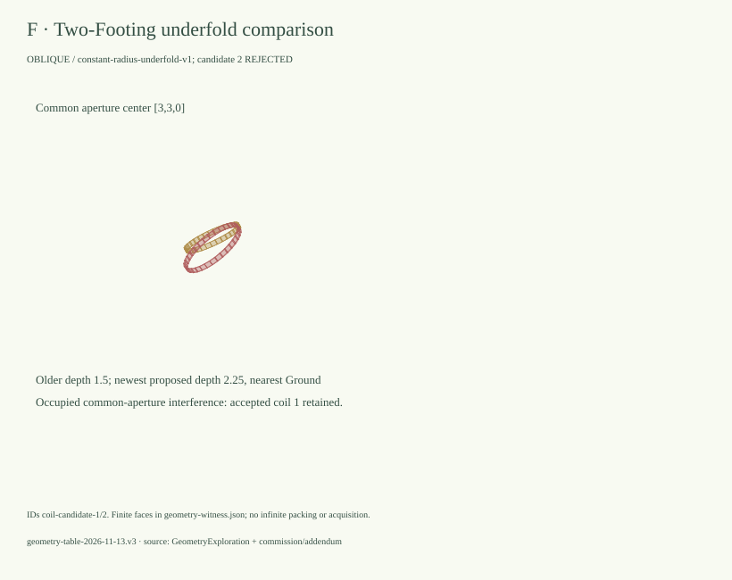

# Open Geometric Questions and Experimental Witnesses

[Geometry RE-surfacing Table](README.md) · Version `geometry-table-2026-11-13.v4`

**OPEN ARCHITECTURAL QUESTION.** Final interlocking HERE/NEXT constitutional inscription, provisional ceiling occasion name, total securing dependency order and final public half-screen arrangement await Richard's review.

**UNPROVED MECHANICAL OR OPTICAL RELATIONSHIP.** Priority witnesses are: actual center aperture passage; occupied pair of folded-under coils; finite hinge contact; material supply/return conservation; asymptotic packing with finite thickness; candidate Gallery axle attachment; Doll/Craft physical relation; and optical UP ACROSS DOWN curvature. Established duties survive these implementation gaps.

Smallest next experiment: retain ONE finite-width coil, propose the SECOND THROUGH the same aperture center with a named hinge and retained entrance. Display all interfering solid face IDs at the first failed interval. Do not move the center to force a pass. If a physical folding pair is supplied, register it as a new reviewed mechanism version, replay both coils and only then consider securing and actual Footing acquisition.

See the [validation and integration report](validation-report.md). A rejected candidate is a useful witness; it is not permission to call a mathematical curve a clear tunnel.

**ESTABLISHED ARCHITECTURAL REQUIREMENT — [R20](diagonals-pillar.md).** The Diagonal B addendum establishes the current-turn measure and inherited basis; it does not appoint the physical joining point, material interface or deformation law of subsequent YT TOWARD YT.

The SVG declares view, frame, material IDs and qualification. Relational drawings are not 3D folding proof.

Implementation: `lib/public_situation_machine_turn_zero/workshop/geometry_exploration.ex` and `lib/public_situation_machine_turn_zero_web/components/geometry_exploration_panel.ex`, unless historical sources are explicitly named above. Current tests: `test/public_situation_machine_turn_zero/geometry_exploration_test.exs` and the matching LiveView/browser tests. Source authority: [commission](commission-2026-11-13.txt), relevant named section; verification status in [report](validation-report.md).

Adjoining records: [Historical Geometry, Supersession, and Repository Reconciliation](history-reconciliation.md) · [Constitutioning Human, HERE, and Landingings](human-here-landingings.md).
