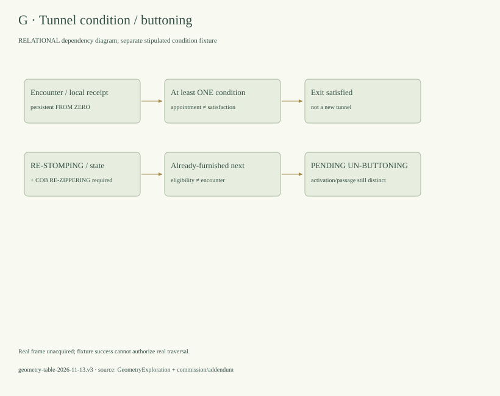

# PENDING UN-BUTTONING, Tunnel Conditions, and Return Course

[Geometry RE-surfacing Table](README.md) · Version `geometry-table-2026-11-13.v4`

**ESTABLISHED ARCHITECTURAL REQUIREMENT — R13.** Encounter, local Footing acquisition, authored condition appointment, satisfaction, exit completion, eligibility, button encounter/activation, passage and protected RE-STEP are separate occasions. A Footing requires at least one condition; presence is permitted. COB remains FROM ZERO after a local Footing.

**ESTABLISHED ARCHITECTURAL REQUIREMENT — R14.** PENDING UN-BUTTONING does not manufacture a tunnel or acquire extent. STAND TOWARD THIS ONE BUTTONING requires completed standing, conditions, exit, RE-STOMPING/state readiness and COB RE-ZIPPERING, with already-furnished next passage. Readiness is not encounter or activation. Earlier entry-into-contraption office remains source ancestry, not a renamed generic NEXT.

**SOURCE-BACKED IMPLEMENTED GEOMETRY.** A clearly labeled condition-contract rehearsal can simulate these evidence slots independently. It uses a separate fixture context, never the unacquired geometry run. Presence/exit controls alone cannot unlock the public outreading; completion/securing/next-passage slots are also required. Actual traversal and real local acquisition remain blocked.

**CANDIDATE EXPERIMENT — R15.** Ceiling occasion has provisional name `ceiling-reference-inspected`, measured extent SIX, bearing/return references and no index change. Inspection of a ceiling reference must not claim an actual COB arrival. An actual ceiling arrival would require lawful acquired locality and occupied passage evidence.

N18/U13 return IDs remain provenance witnesses. Coplanar arrival at U13 is not transverse passage; return still needs finite incidence, supply and clearance proof.

The SVG declares view, frame, material IDs and qualification. Relational drawings are not 3D folding proof.

Implementation: `lib/public_situation_machine_turn_zero/workshop/geometry_exploration.ex` and `lib/public_situation_machine_turn_zero_web/components/geometry_exploration_panel.ex`, unless historical sources are explicitly named above. Current tests: `test/public_situation_machine_turn_zero/geometry_exploration_test.exs` and the matching LiveView/browser tests. Source authority: [commission](commission-2026-11-13.txt), relevant named section; verification status in [report](validation-report.md).

Adjoining records: [Little ROUNDING Footings, Accretioning, and Asymptotic Folding](footings-accretion-folding.md) · [Roundabout Gallery, Axle Curvature, Pocketings, and Map Regarding](gallery-axle-map.md).

Current [JANUSITE / shared-YT / ONE-to-TWO refinement](janusite-shared-yt-one-two.md) adds R27–R30 without repairing the preserved v4 failed fit or granting acquisition.

V7 material co-building refinement: [R37–R43](co-building-material-2026-11-15.md) and [finite geometry / interfaces / witnesses](co-building-engineering-report-2026-11-15.md). Earlier source registrations and their versioned scope remain retained.

## Gallery course refinement — v8

[R44–R47 and engineering witness](gallery-course-v8-2026-11-15.md) register the undercurve, Gallery departure, finite upper loop and continuous source course TOWARD a distinct flat next PINNING. `GalleryCourse` adds source geometry; `CoBuilding` composes source section slices, inspection stages and separate lifecycle identities. The old v7 course is retained in the archived export and metadata. ArchitectureLive adds one inspection command; the function component adds stages/overlays and DOWN Tunneling. No standing-store or protected-operation adapter changes. Upper-loop/departure interference remains an observed YELLOW failure.

## THREE–FOUR / offset passage — v9

[Rules R48–R50 and bounded witness](three-four-offset-v9-2026-11-15.md) add `ThreeFourStudy`, finite candidate material and source-addressed offset arc references. `CoBuilding` gains isolated material-refashioning, conditional-proposal and projection state; ArchitectureLive adds only corresponding inspection handlers; the component exposes independent overlays/status and encounter cursor records. All v8 source meshes and existing actual standing are preserved. Physical ceiling/Tunnel incidence and whole occupied clearance remain YELLOW; measured reference order is not actual COB Traversaling or acquisition. Earlier reports and exports retain their own versions.

## Double Gallery passage — v10 / 16 November 2026

[R52–R53 and bounded return](double-passage-v10-2026-11-16.md) add `DoublePassageStudy`, one source sweep sliced into outward/AROUND/return, measured opening-plane incidence and central corridor checks. `CoBuilding` composes new prospective listings; the existing Gallery frame uses its identical original coordinates from the shared Door reference. The component/ArchitectureLive add inspection only, with colour distinction and close-up view; scoped CSS styles the two courses. Previous source meshes, actual standing and protected operations are unchanged. Eight measured boundary samples do not establish recurring four-point furnishing. Exact incidence, joins, whole occupied clearance and inaugural-to-recurring relation remain YELLOW.
