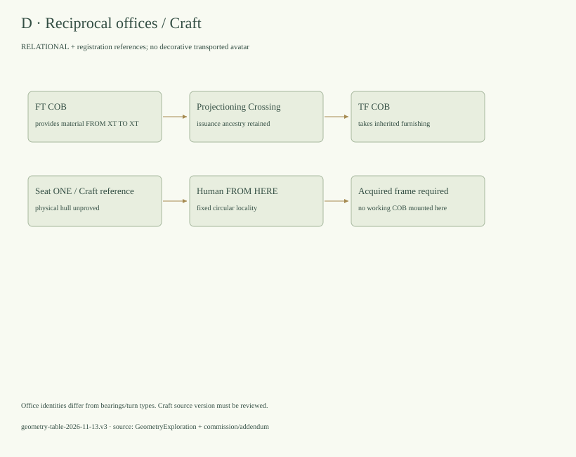

# FT COB, TF COB, Traversaling Craft, and Reciprocal Offices

[Geometry RE-surfacing Table](README.md) · Version `geometry-table-2026-11-13.v4`

**ESTABLISHED ARCHITECTURAL REQUIREMENT — R08.** FT COB is Furnishing Traversaling COB; TF COB is Traversaling Furnishing COB. Furnishing provides authored material; taking inherits it. A YT selector may not create material. Both offices may Regard Tunneling; fashioning needs an appropriate flat surface. Screen office keys do not automatically identify geometric bearings or turn types.

**ESTABLISHED ARCHITECTURAL REQUIREMENT — R09.** THE CONSTITUTIONING HUMAN MUST LAWFULLY ACQUIRE ANY EXTENT WITHIN WHICH THE COB MAY STAND WORKING. A source-backed experimental take is not proof of this complete contract.

**CANDIDATE EXPERIMENT.** New Craft reservation is anchored to Seat ONE at [3,1,−3], with a bearing toward Crossing [3,3,0]. This is an inspection reference with no occupied Craft hull and no working COB. The TF marker stays blocked/unmounted because the frame is unacquired. FT previews supply candidate geometry; preview is neither actual working nor acquiring. Both offices share the same top-down material map.

**SUPERSEDED HISTORICAL ASSUMPTION.** `ComingAboardMachine.registration/0` Craft Seat [0,6,2] and Traversaling Seat [0,0,2] cannot govern the revised ONE/THREE/SIX relationships. Preserve this old extent-frame witness with its own version; do not teleport its Craft into the new frame or attach it to screen coordinates.

**ESTABLISHED ARCHITECTURAL REQUIREMENT — [R21–R23](un-vanishing-aperture.md).** FT candidate furnishing and TF permitted taking/working remain distinct. Stipulated reference or candidate staging cannot mount a working COB. After lawful Landinging acquisition, any permitted Segmentationing scan remains within the Human’s same lawfully acquired frame. See [staging](table-crossing-staging.md), [acquisition](lawful-acquisition.md) and [angular hypothesis](gallery-axle-map.md).

The SVG declares view, frame, material IDs and qualification. Relational drawings are not 3D folding proof.

Implementation: `lib/public_situation_machine_turn_zero/workshop/geometry_exploration.ex` and `lib/public_situation_machine_turn_zero_web/components/geometry_exploration_panel.ex`, unless historical sources are explicitly named above. Current tests: `test/public_situation_machine_turn_zero/geometry_exploration_test.exs` and the matching LiveView/browser tests. Source authority: [commission](commission-2026-11-13.txt), relevant named section; verification status in [report](validation-report.md).

Adjoining records: [JANUSITE, Triangles, Squares, Circle, and Material Folding](janusite-material.md) · [Constitutional RE-STEP and Lawful Acquisition](lawful-acquisition.md).
