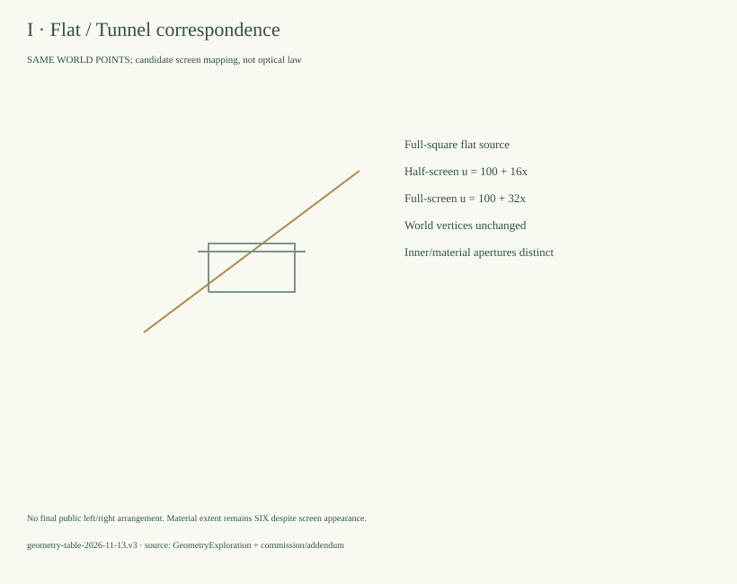

# Flat, Tunnel, THROUGH, ALONG, and Other Regardings

[Geometry RE-surfacing Table](README.md) · Version `geometry-table-2026-11-13.v4`

**ESTABLISHED ARCHITECTURAL REQUIREMENT — R17.** Physical monitor, inner aperture and cabinet/material aperture remain three surfaces. Source geometry and identities survive camera or map changes. Pinned Doll-head seam and Glass remain in their original registered witnesses.

**CANDIDATE EXPERIMENT.** Full flat presentation and a half-screen comparison project the SAME world vertices into different screen transforms. A central bar and changed projected aperture width are composition choices, not an optical/material law. The half-screen comparison keeps HERE/monitor labels and identifies which material is only proposed. No final public left/right layout is appointed.

Section/elevation is XY at Z=0, plan is XZ, transverse is ZY. These are orthographic projections. An oblique view is a viewing basis, not a perspective lens. A flattened coil can look self-crossing while its source vertices remain different; screen overlap cannot establish material contact.

**UNPROVED MECHANICAL OR OPTICAL RELATIONSHIP.** THROUGH-ALONG open tunnel appearance and optical curvature are not certified occupied traversal. Changes in occlusion and apparent extent do not establish newly acquired material outside SIX.

**ESTABLISHED ARCHITECTURAL REQUIREMENT — [R20](diagonals-pillar.md).** A hidden-by-default joining-reference overlay can expose the prospective YT TOWARD YT relationship. It is an empty-material diagnostic, not new Projectioning or accomplished extent beyond Diagonal B.

**ESTABLISHED ARCHITECTURAL REQUIREMENT — [R21–R23](un-vanishing-aperture.md).** The alongside witness projects identical material/aperture vertices in flat, transverse Gallery profile and plan views. Camera pivot, wedging appointment, staging and candidate furnishing have distinct records. No camera change establishes FROM DOWN UNDER. See [staging](table-crossing-staging.md), [acquisition](lawful-acquisition.md) and [angular hypothesis](gallery-axle-map.md).

The SVG declares view, frame, material IDs and qualification. Relational drawings are not 3D folding proof.

Implementation: `lib/public_situation_machine_turn_zero/workshop/geometry_exploration.ex` and `lib/public_situation_machine_turn_zero_web/components/geometry_exploration_panel.ex`, unless historical sources are explicitly named above. Current tests: `test/public_situation_machine_turn_zero/geometry_exploration_test.exs` and the matching LiveView/browser tests. Source authority: [commission](commission-2026-11-13.txt), relevant named section; verification status in [report](validation-report.md).

Adjoining records: [Roundabout Gallery, Axle Curvature, Pocketings, and Map Regarding](gallery-axle-map.md) · [DIRT Geometry and Acquisition Provenance](dirt-geometry-provenance.md).
