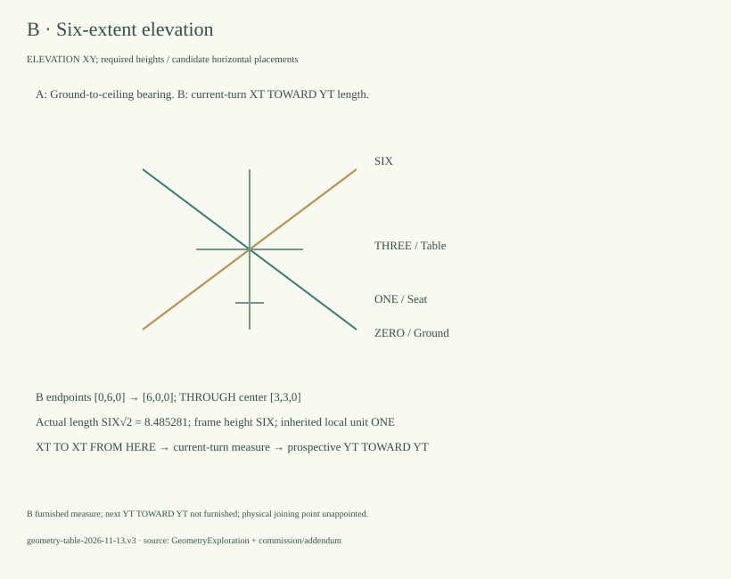

# Six-Extent CUBICAL Registration and RE-STEPPING Framing

[Geometry RE-surfacing Table](README.md) · Version `geometry-table-2026-11-13.v4`

**ESTABLISHED ARCHITECTURAL REQUIREMENT — R03.** Default frame is SIX BY SIX BY SIX. Ground-to-ceiling height is appointed before any Little ROUNDING Footings. Table THREE does not add six above itself. Constitutional frame measure SIX is distinct from FOUR/SIX/EIGHT reference gauges. THREE/TWELVE remain separately appointable comparisons; this bounded exploration keeps default SIX.

**ESTABLISHED ARCHITECTURAL REQUIREMENT — R04.** The room, frame, material provisions, Ground securing machinery and minimum TWO-Footing capacity precede the Human's consequential RE-STEP. Capacity is not two already-fashioned Footings.

**SOURCE-BACKED IMPLEMENTED GEOMETRY.** `GeometryExploration.frame/0` registers [0,0,0]..[6,6,6], Ground Y=0 and ceiling Y=6. Default capacity is at least two with initially no candidate folds. Neither adding specimens nor ceiling inspection resizes this frame.

**UNPROVED MECHANICAL OR OPTICAL RELATIONSHIP.** This mathematical room registration does not supply PITTONING, RE-STOMPING or securing. Ready experimental registration is not ready protected acquisition. Perspective extent outside a flat view never becomes additional material extent.

**ESTABLISHED ARCHITECTURAL REQUIREMENT — [R20](diagonals-pillar.md).** Diagonal A supplies the ascending Ground-to-ceiling bearing; Diagonal B supplies the current-turn XT TOWARD YT measure. Its SIX√2 length is not frame height SIX. No subsequent YT TOWARD YT extent follows automatically from either reference.

The SVG declares view, frame, material IDs and qualification. Relational drawings are not 3D folding proof.

Implementation: `lib/public_situation_machine_turn_zero/workshop/geometry_exploration.ex` and `lib/public_situation_machine_turn_zero_web/components/geometry_exploration_panel.ex`, unless historical sources are explicitly named above. Current tests: `test/public_situation_machine_turn_zero/geometry_exploration_test.exs` and the matching LiveView/browser tests. Source authority: [commission](commission-2026-11-13.txt), relevant named section; verification status in [report](validation-report.md).

Adjoining records: [Constitutioning Human, HERE, and Landingings](human-here-landingings.md) · [XT TO XT, XT TOWARD YT, Diagonal Bearings, and the Continuous Pillar](diagonals-pillar.md).

**ESTABLISHED ARCHITECTURAL RELATIONSHIP — [R25/R26](here-wedging-snail-six.md).** HERE is not merely a post: seated ONE stands THROUGH its local wedging, TOWARD THREE/OVER ACROSS, with required Snail House registration THROUGH SIX. SIX frame, local XT TO XT and prior acquisition duties remain established. Return-line intersection, occupied joining, optics and securing are UNPROVED IMPLEMENTATION MECHANISMS; a registered cube alone proves no lawful acquisition. Compare the [two bounded trials](here-wedging-snail-six.md).

The [local 45° comparison](bearing-registration-study.md) registers two 3×3×3 boxes along Z inside SIX. Their full common face registers independently of the tested bearings and the failed finite stock placements. A third reference extends beyond SIX.

Current [v6 assembled CUBICAL / Crossing requirements R31–R36](cubical-construction-2026-11-15.md) preserve this source witness. Initial straight-UP approach, whole-frame versus local ceilings, distinct LEFT/RIGHT material and THREE/FOUR comparison must be read under that refinement. No historical candidate or failed fit becomes actual acquisition.

V7 material co-building refinement: [R37–R43](co-building-material-2026-11-15.md) and [finite geometry / interfaces / witnesses](co-building-engineering-report-2026-11-15.md). Earlier source registrations and their versioned scope remain retained.

## ROOM Toy Box refurnishing — v11 / 16 November 2026

[Rules R54–R61 and four-movement evidence](room-toy-box-v11-2026-11-16.md) apply the source commission and square-axle correction. New `RoomToyBox`/`RoomRibbon` constructors compose preserved v10 material with a tested common ROOM frame, solid opposite-corner bearing, explicit axle ZERO TO ONE, source-derived U candidates, finite under-return and source-bound stands. `RoomToyBoxPanel`, scoped CSS and narrow ArchitectureLive integration provide the primary material/control ledger; older panels remain in a labelled historical disclosure. No protected-operation adapter or consequential persistence changes. Root foundation, source attachment and SIXTH/EIGHTH joining remain YELLOW; new U/R-wall port interference is reported, not accepted. Historical constructors, meshes and reports are not rewritten.
