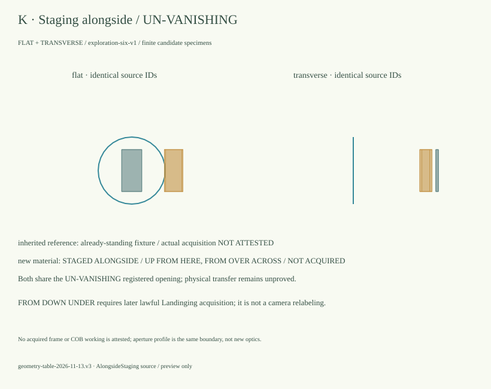
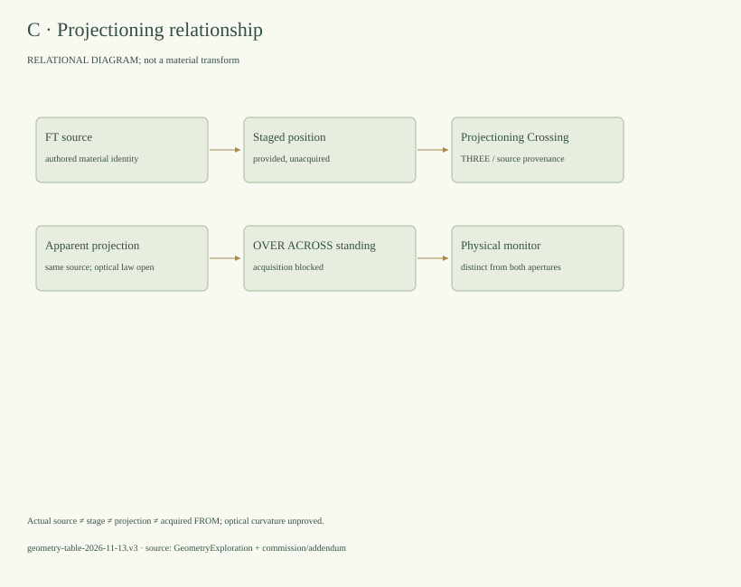

# Standing Up Table, Projectioning Crossing, and Staging

[Geometry RE-surfacing Table](README.md) · Version `geometry-table-2026-11-13.v4`

**ESTABLISHED ARCHITECTURAL REQUIREMENT — R06.** Standing Up Table and Projectioning Crossing have office THREE within the Ground ZERO→SIX framing. Distinguish actual source, staged position, projectioned appearance and actual standing. An apparent instrument origin cannot replace its furnished ancestry.

**CANDIDATE EXPERIMENT.** Exploration Table center [3,3,0], aperture center identical; trial width THREE and radius 0.4 opening. Table/monitor/inner aperture/material aperture are distinct IDs and surfaces. Candidate return and specimen attachment are measured against those IDs. Geometry values beyond the named heights are workshop appointments.

**SOURCE-BACKED IMPLEMENTED GEOMETRY.** Historical A04 U13, nested U and toe-fixed opening remain source witnesses in `MaterialRibbon.crossing/0` and `aperture/0`. Their coordinate origins and THREE registration differ from the new frame; no automatic metric equality is asserted.

**UNPROVED MECHANICAL OR OPTICAL RELATIONSHIP.** UP ACROSS DOWN curved aperture presentation is not explained by rigid 45-degree pivot. The source aperture remains straight under a rigid transform. A04 ray-center registration does not establish a physical lens or material passage.

**ESTABLISHED ARCHITECTURAL REQUIREMENT — [R20](diagonals-pillar.md).** Diagonal B resolves THROUGH Crossing center as the current-turn measure. The reference line does not Projection new YT TOWARD YT beyond itself; actual furnishing and lawful acquisition remain separate from the prospective joining relation.

**ESTABLISHED ARCHITECTURAL REQUIREMENT — R21.** THE HUMAN STAGES MATERIAL ALONGSIDE ALREADY-STANDING MATERIAL. BOTH MAY STAND UP FROM HERE OVER ACROSS. Newly staged material is staged THROUGH-BY standing UP FROM HERE, FROM OVER ACROSS. Shared Projectioning does not imply shared provenance or lawful acquisition. In particular, new staging does not automatically inherit FROM DOWN UNDER from an instrument, neighboring material or a camera.

Keep separate records for inherited standing, new staging, each material source, their shared opening/Projectioning and their respective acquisition status. A staged source must remain identifiable after a later furnishing or change of Regarding.

**SOURCE-BACKED IMPLEMENTED GEOMETRY.** The [alongside witness](validation-report.md) preserves an explicitly stipulated already-standing reference fixture, new finite specimens and a shared registered opening. The fixture does not attest an actual acquired Human frame. New material has `UP FROM HERE OVER ACROSS`, separate `THROUGH-BY` and `STAGED ALONGSIDE` relations, never a current FROM DOWN UNDER relation.

See [UN-VANISHING aperture R23](un-vanishing-aperture.md), [later acquisition R22](lawful-acquisition.md), [angular axle hypothesis R24](gallery-axle-map.md) and the [source addendum](alongside-staging-addendum-2026-11-13.txt).

The SVG declares view, frame, material IDs and qualification. Relational drawings are not 3D folding proof.

Implementation: `lib/public_situation_machine_turn_zero/workshop/geometry_exploration.ex` and `lib/public_situation_machine_turn_zero_web/components/geometry_exploration_panel.ex`, unless historical sources are explicitly named above. Current tests: `test/public_situation_machine_turn_zero/geometry_exploration_test.exs` and the matching LiveView/browser tests. Source authority: [commission](commission-2026-11-13.txt), relevant named section; verification status in [report](validation-report.md).

Adjoining records: [XT TO XT, XT TOWARD YT, Diagonal Bearings, and the Continuous Pillar](diagonals-pillar.md) · [JANUSITE, Triangles, Squares, Circle, and Material Folding](janusite-material.md).

**ESTABLISHED ARCHITECTURAL RELATIONSHIP — [R25/R26](here-wedging-snail-six.md).** HERE is not merely a post: seated ONE stands THROUGH its local wedging, TOWARD THREE/OVER ACROSS, with required Snail House registration THROUGH SIX. SIX frame, local XT TO XT and prior acquisition duties remain established. Return-line intersection, occupied joining, optics and securing are UNPROVED IMPLEMENTATION MECHANISMS; a registered cube alone proves no lawful acquisition. Compare the [two bounded trials](here-wedging-snail-six.md).
