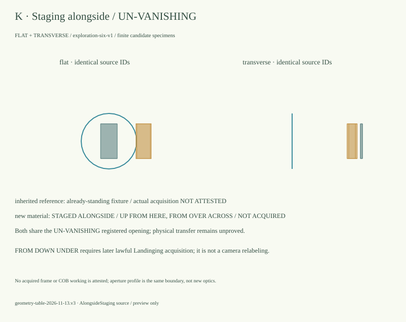

# UN-VANISHING registered aperture and shared Projectioning

[Geometry RE-surfacing Table](README.md) · `geometry-table-2026-11-13.v4`.

**ESTABLISHED ARCHITECTURAL REQUIREMENT — R23.** The UN-VANISHING POINT is a registered opening TOWARD Regarding whatever comes to stand FROM that relation, not merely a perspective vanishing point or decorative endpoint. The Human may stage new material alongside already-standing material THROUGH-BY that opening. The Roundabout Gallery permits transverse Regarding of the aperture. Neither shared Projectioning nor staged appearance establishes the later acquired Groundward relationship.

**SOURCE-BACKED IMPLEMENTED GEOMETRY.** `AlongsideStaging.aperture/0` gives the opening a distinct identity, center, normal, finite boundary, source frame and qualification. All material records reference that same opening/Projectioning identity. Flat, transverse profile and plan project the same source arrays; a camera-basis pivot changes only the computed appearance.

**CANDIDATE EXPERIMENT.** Center [3,3,0], radius 0.4 and normal +Z are an explicitly appointed comparison registration in `exploration-six-v1`, at the Crossing THREE reference. This is not an identity assertion with the existing horizontal Table `inner-aperture` or the separate `material-aperture` at Z=0.3. Sharing a center is not a proven physical correspondence. The physical monitor remains distinct.

**UNPROVED MECHANICAL OR OPTICAL RELATIONSHIP.** Projected links from opening to material are reference rays, not occupied pipes, receipt or proof that a finite sheet traverses that opening. Material passage, aperture mounting/optics and the mechanism producing occupied Gallery curvature remain unproved. Source material standing UP FROM HERE OVER ACROSS must not be relabeled FROM DOWN UNDER by a camera change.

Related authorities: [staging R21](table-crossing-staging.md), [later acquisition R22](lawful-acquisition.md), [angular hypothesis R24](gallery-axle-map.md), [Diagonal B R20](diagonals-pillar.md), [DIRT lifecycle](dirt-contract.md#alongside-staging-and-acquired-relationship-lifecycle). Source: [byte-preserved addendum](alongside-staging-addendum-2026-11-13.txt). Implementation/evidence: [validation report](validation-report.md).
